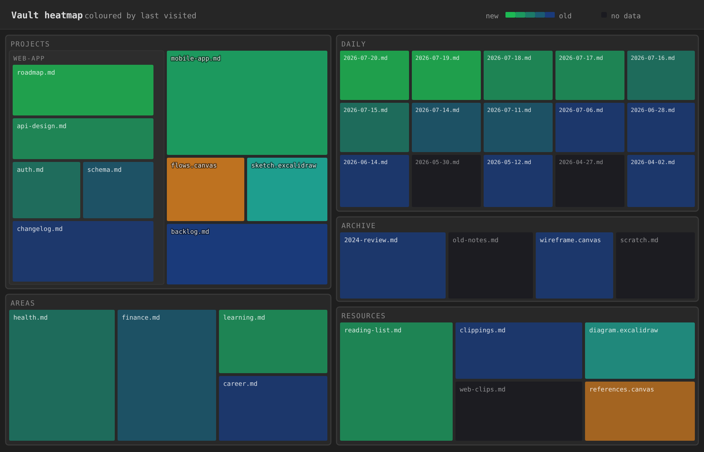
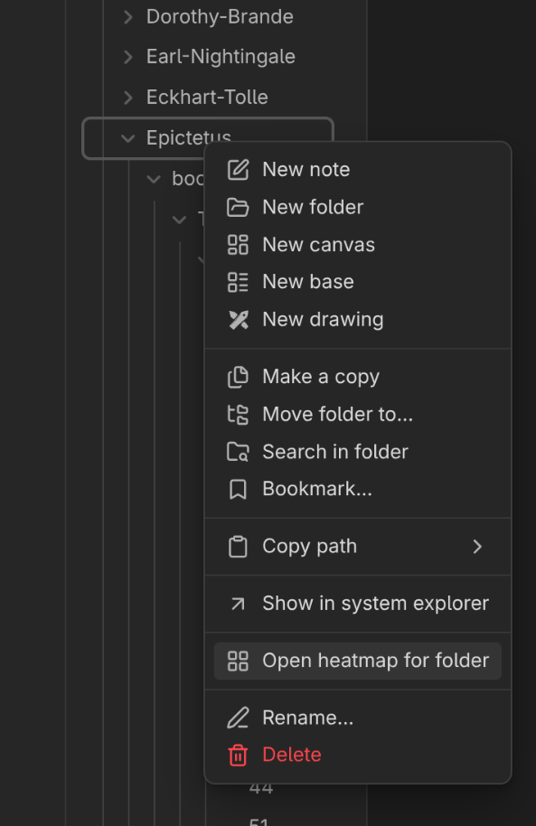

# Visit History

See which notes you *actually* spend time in. Visit History records how long you
focus on each note, canvas, and Excalidraw drawing, and shows your whole vault as
an **activity heatmap**. Fully offline: no network calls, no accounts, no
telemetry.



*Brighter green = visited recently, deep blue = long ago, dim = no data yet.*

## Key features

- **Vault heatmap** — a zoomable treemap of every file, coloured by when it was
  last **visited**, **modified**, or **created**.
- **Size by visit time** — make the files you spend the most time in the biggest
  on the map (or size by file size).
- **Automatic visit recording** — focus time per document, with idle detection.
  No manual tracking.
- **History survives renames** — moving or renaming a note keeps all of its history.
- **Inline a note** — merge a small note into the one note that links to it,
  content *and* visit history, in one step.
- **Plain-text, local data** — one readable text file per document, inside your
  vault.

## Quick start

1. Install from **Settings → Community plugins → Browse**: search for **Visit
   History** and enable it.
2. Confirm a short user name when asked. It only keeps histories apart when
   several people share a vault.
3. Run **Open vault heatmap** from the command palette or the ribbon. Colour by
   **modified** to get a useful view right away; visit-based colouring fills in
   as you use your vault.

## The heatmap

Every file is a rectangle nested inside its folders.

- **Colour** by when a file was last **visited**, **modified**, or **created**,
  or by **type** (note / canvas / Excalidraw). Tune the gradient and hot/cold
  thresholds to fit your vault.
- **Size** by **content size** or **visit time** (total time spent in the file;
  never-visited files are hidden). A **Linear / Sqrt / Log** curve keeps a few
  huge files from crowding out the rest.
- **Navigate**: click a folder to drill in, click a file to open it, pan and
  zoom with the mouse.
- **Filter** by **path** or by text **content**; a file shows if it matches *any*
  term.
- **`_archive` folders are hidden**. Open one from its folder menu to look inside.
- **Open for a single folder** from its menu in the file explorer:



All heatmap options are saved automatically.

## Inline a note

Have a small note that only one other note links to? From the small note's file
menu or the command palette, run **Inline note (visit history aware)**. You can
also click the inline icon shown when you hover a `![[note]]` embed of it.

- Its content goes right after the link, with headings shifted to fit. Its
  properties are added to the receiving note; existing ones are kept as they are.
- Its visit history now counts toward the receiving note.
- The small note then goes to the trash.

It only runs when the whole vault (canvases included) has **exactly one** link
to the note; otherwise a dialog explains why. You confirm before anything
changes, and if any step fails, the original note is kept.

## How recording works

While a note, canvas, or Excalidraw drawing is in focus, the plugin times it.
When you navigate away, switch windows, open Settings, or go idle, it saves that
session (start time + duration). Visits under 2 seconds are not recorded.

The first time you open a document, it gets a small permanent **id** (stored in
the note's frontmatter or the canvas's metadata). History is saved under that id,
not the path, so renames and moves keep it.

**Where it's saved:** the hidden `.plugin_data/visit_history/` folder in your
vault, organised per user and per device. Because the folder is hidden, it stays
out of the file explorer and search. **Obsidian Sync skips hidden folders**, so
with Obsidian Sync, each device keeps its own history. History from older
versions (`.visit_history/`, `__visit_history/`) is moved there automatically.

## Settings

Under **Settings → Visit History**:

- **Idle timeout (seconds)** — no interaction for this long ends the current
  session (default 180).
- **Minimum focus time (seconds)** — shorter visits are not recorded (default 2;
  0 records everything).
- **Add ids to all eligible files** — assigns the permanent id to every note and
  canvas now, instead of on first open. Modifies files, so it asks for
  confirmation first.

## On the roadmap

Not built yet:

- **Journey visualization** — replay the path you took through your notes over a
  session or a day.
- **Nearby search** — find notes you visited *around the same time* as a given
  note, even when they aren't linked.

## Data format

Your history is plain text:

```
.plugin_data/visit_history/
  user/
    <your-name>/
      v3/
        README__generated__vh_v3_format.md   # this format, written by the plugin
        focus_duration_per_device/
          <device-name>/                     # each device writes only its own folder
            <doc-id>.vh_v3                   # one file per document
        merged_in_focus_duration_per_device/ # history of inlined notes
```

The file name is the document's permanent id. Each line is one completed focus
session: start time (ISO 8601 UTC) plus the time spent in focus, in milliseconds.
For example, a 5.6-second visit:

```
2026-07-09T22:02:15.745Z D:5600
```

## Appendix: file times after a `git` clone

**Created** and **modified** colouring use your files' timestamps. Git doesn't
keep them, so after a clone or pull the whole vault looks freshly modified. Run
[`git restore-mtime`](https://github.com/MestreLion/git-tools) in your vault to
reset each file's modified time to its last commit. Visit-based colouring is
unaffected.

## For plugin developers

To use visit history data (visit stats, heatmap colors) from your own plugin,
see [API.md](API.md).

## License

Released under the Kondratyev Source Available License (KSAL-3.0). See [LICENSE.md](LICENSE.md).

In short:

- **Use it anywhere.** Personal vaults, work vaults, client work, companies of any size. No restrictions on what you do with the notes and data you produce.
- **Free features are free.** Some features may be gated behind a license key in the future and require a payment. You may not remove, disable, or bypass those checks.
- **Source is available, not strictly open.** You may read, study, and modify the code for noncommercial purposes. You may not sell it, distribute it commercially, ship it inside a product, or run it as a hosted service.

For commercial licensing, reach out.
